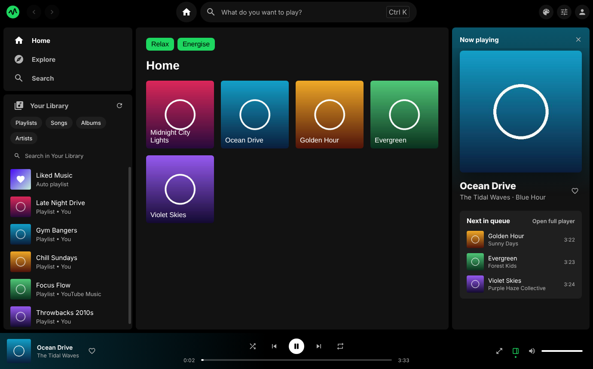

# Tunewave

A Spotify-style desktop player for **YouTube Music**. Sign in with your own YouTube Music / YouTube Premium account and get a Spotify-like layout with 12 themes.




*Screenshots use test data.*

## Run it (Windows)

Download `Tunewave-Portable-X.Y.Z-Windows.zip` from the [Releases](../../releases) page. Then:

1. Unzip it somewhere permanent, e.g. `C:\Users\<you>\Apps\Tunewave`.
2. Double-click **Tunewave.exe**. To pin it, right-click the running icon in the taskbar and choose **Pin to taskbar**.
3. Windows SmartScreen may say "Windows protected your PC" because the app isn't code-signed. Click **More info → Run anyway**.
4. Click **Sign in** in the sidebar. If you're already signed in to Google in your default browser (Firefox, Chrome, Edge or Brave), Tunewave reuses that login straight away — you may not even see a window. If you're not signed in, your browser opens Google's sign-in page (with your saved passwords and passkeys available, including scanning a QR code with your phone); finish there and Tunewave continues on its own. You only need to do this once.

   *Why a browser?* Google blocks sign-in inside apps' built-in windows ("This browser or app may not be secure"). Tunewave reads only the YouTube/Google login cookies and never touches your password. On Firefox it reuses your normal profile; on Chrome/Edge/Brave it uses a clean temporary one.

   *Why a browser?* Google blocks sign-in inside apps' built-in windows ("This browser or app may not be secure"). Tunewave copies only the YouTube/Google login cookies from that temporary window and then deletes it.

## Features

- Spotify-style layout: sidebar with Home / Explore / Search and **Your Library** (your playlists, Liked Music, and filters for Playlists / Songs / Albums / Artists), a top search bar, a **Now Playing** panel with big cover art and the upcoming queue, and a bottom player bar.
- **12 themes** (Classic Green, Redline, Midnight, Deep Ocean, Sunset, Sakura, Forest, Dracula, Nord, Gruvbox, OLED Mono, Synthwave), plus a custom accent colour.
- **Album-art colours**: the player and Now Playing panel pick up the colours of the current cover. You can also let the accent colour follow the cover.
- Clicking a song keeps you on the page you were browsing, like Spotify, instead of jumping to YouTube Music's full-screen player. Use the ⤢ button to open the full player (with lyrics and related songs) whenever you want it.
- Media keys and the Windows media overlay, taskbar thumbnail buttons (prev / play / next), remembered window size and volume.
- **System tray** with play/pause/next and show/hide, plus optional close-to-tray and minimise-to-tray so music keeps playing in the background.
- **Global media keys** that work even when Tunewave isn't focused.
- **Stays signed in**: refreshes your login from your browser in the background so Google doesn't sign you out.
- Click any song in the Now Playing queue to jump straight to it.
- Keyboard: `Space` play/pause · `Ctrl+→/←` next/previous · `Ctrl+↑/↓` volume · `M` mute · `Ctrl+K` search · `Alt+←/→` back/forward · `Ctrl+R` reload.

## If something breaks

YouTube sometimes changes its website. If a button stops working, open **Settings → Show original YouTube Music controls** to get YouTube's own controls back while you wait for a fix. The code that talks to the YouTube Music page is all in `src/renderer/ytm-bridge.js`.

## Making a release

Releases are automatic. Every push to `main` builds the Windows app with GitHub Actions. When the `version` in `package.json` hasn't been released yet, a new GitHub Release (`vX.Y.Z`) is created with the portable zip, `Tunewave-Portable-X.Y.Z-Windows.zip`.

Tunewave checks GitHub for new releases when it starts and every few hours, and shows an **Update available** button that opens the download page.

To publish an update, bump `version` in `package.json` (e.g. `1.3.0` → `1.3.1`) and push.

*The Windows installer is shelved for now, because Windows 11 Smart App Control blocks unsigned installers. The installer and its self-updating code are still in the project, ready for when the app is code-signed.*

## Build from source

Requires Node.js 20+.

```
npm install
npm start               # run in development
npm run build:win       # Windows installer + zip in dist/
```

## Privacy

Tunewave has no servers, no account system and no telemetry. Your login is
stored only on your own computer, and the only networked systems it talks to are
Google / YouTube (to sign in and play music, at your request) and GitHub (to
check for updates). See [PRIVACY.md](PRIVACY.md) for the full policy.

## Code signing policy

Tunewave is applying to the SignPath Foundation open-source program so that
Windows release binaries can be code-signed. See
[CODE_SIGNING_POLICY.md](CODE_SIGNING_POLICY.md) for the full policy, including
team roles and the release/signing process.

> Free code signing provided by [SignPath.io](https://signpath.io/), certificate by [SignPath Foundation](https://signpath.org/).

## Notes

- Tunewave loads the official music.youtube.com inside the app. Your login, Premium perks (no ads, background play, downloads in the official apps) and library all come from your account. Google's own sign-in page handles your password, and Tunewave never sees it.
- This is an unofficial personal project and is not affiliated with Google, YouTube or Spotify.
