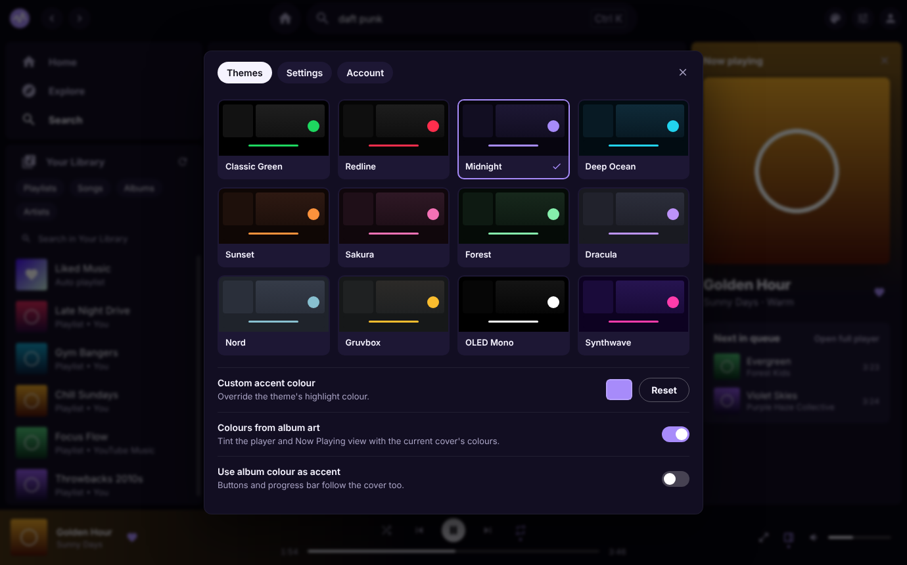

# Tunewave

A Spotify-style desktop player for **YouTube Music**. Sign in with your own YouTube Music / YouTube Premium account and get a Spotify-like layout with 12 themes.




*Screenshots use test data.*

## Run it (Windows)

Download the latest installer (`Tunewave Setup x.y.z.exe`) or zip from the [Releases](../../releases) page. If you use the zip:

1. Unzip it somewhere permanent, e.g. `C:\Users\<you>\Apps\Tunewave`.
2. Double-click **Tunewave.exe**. To pin it, right-click the running icon in the taskbar and choose **Pin to taskbar**.
3. Windows SmartScreen may say "Windows protected your PC" because the app isn't code-signed. Click **More info → Run anyway**.
4. Click **Sign in** in the sidebar. Google's sign-in page opens in a small separate window (its title bar shows which site you're on). Sign in with the Google account that has Premium, and the window closes by itself when you're done. You only need to do this once.

## Features

- Spotify-style layout: sidebar with Home / Explore / Search and **Your Library** (your playlists, Liked Music, and filters for Playlists / Songs / Albums / Artists), a top search bar, a **Now Playing** panel with big cover art and the upcoming queue, and a bottom player bar.
- **12 themes** (Classic Green, Redline, Midnight, Deep Ocean, Sunset, Sakura, Forest, Dracula, Nord, Gruvbox, OLED Mono, Synthwave), plus a custom accent colour.
- **Album-art colours**: the player and Now Playing panel pick up the colours of the current cover. You can also let the accent colour follow the cover.
- Clicking a song keeps you on the page you were browsing, like Spotify, instead of jumping to YouTube Music's full-screen player. Use the ⤢ button to open the full player (with lyrics and related songs) whenever you want it.
- Media keys and the Windows media overlay, taskbar thumbnail buttons (prev / play / next), remembered window size and volume.
- Keyboard: `Space` play/pause · `Ctrl+→/←` next/previous · `Ctrl+↑/↓` volume · `M` mute · `Ctrl+K` search · `Alt+←/→` back/forward · `Ctrl+R` reload.

## If something breaks

YouTube sometimes changes its website. If a button stops working, open **Settings → Show original YouTube Music controls** to get YouTube's own controls back while you wait for a fix. The code that talks to the YouTube Music page is all in `src/renderer/ytm-bridge.js`.

## Making a release

GitHub Actions builds the Windows installer for you. Push a version tag and the installer and zip get attached to a new release:

```
git tag v1.0.1
git push origin v1.0.1
```

You can also run the **Build Windows app** workflow by hand from the Actions tab. The files appear as a downloadable artifact on the run.

## Build from source

Requires Node.js 20+.

```
npm install
npm start               # run in development
npm run build:win       # Windows installer + zip in dist/
```

## Notes

- Tunewave loads the official music.youtube.com inside the app. Your login, Premium perks (no ads, background play, downloads in the official apps) and library all come from your account. Google's own sign-in page handles your password, and Tunewave never sees it.
- This is an unofficial personal project and is not affiliated with Google, YouTube or Spotify.
